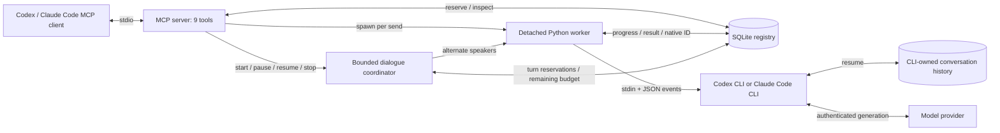

# Local Session Bridge

The `local-sessions` MCP component of [agents-harnesses](../../README.md).

A local stdio MCP server that lets Codex and Claude Code consult named,
persistent discussion partners. Each message runs a fresh CLI process;
the next message resumes that partner's native conversation ID.

Use it to compare designs, challenge an assumption, or continue a technical
discussion across tasks. The bridge manages its own sessions; it does not
inject messages into an already open terminal or desktop chat.

**Status: alpha.** Python 3.11+, macOS/Linux (POSIX process groups and
`flock`). Windows is not supported. At least one supported CLI must be on
PATH and authenticated. Each client chooses when to consult a partner.
An explicitly started dialogue can alternate between both providers within round
and time limits. It is local to this host, not a recurring scheduler.

## Architecture



The server is the control plane, SQLite is the local registry, and a detached
worker owns each CLI invocation. Both MCP clients can share the same registry.
See [アーキテクチャ](docs/architecture.md) and [security boundaries](SECURITY.md).

## Install

From an agents-harnesses checkout:

```sh
cd mcp/local-sessions
python3 -m venv .venv
.venv/bin/python -m pip install .
```

Register the installed executable with your MCP client. Substitute absolute
paths, and use the **same** state path for clients that should share partners.

```sh
codex mcp add local-sessions \
  --env SESSION_BRIDGE_HOME=/absolute/path/to/private-bridge-state \
  -- /absolute/path/to/agents-harnesses/mcp/local-sessions/.venv/bin/session-mcp

claude mcp add local-sessions --scope user \
  -e SESSION_BRIDGE_HOME=/absolute/path/to/private-bridge-state \
  -- /absolute/path/to/agents-harnesses/mcp/local-sessions/.venv/bin/session-mcp
```

For a generic MCP host:

```json
{
  "mcpServers": {
    "local-sessions": {
      "command": "/absolute/path/to/agents-harnesses/mcp/local-sessions/.venv/bin/session-mcp",
      "env": {
        "SESSION_BRIDGE_HOME": "/absolute/path/to/private-bridge-state"
      }
    }
  }
}
```

Reload the client's MCP connection after registration. The bridge works as
`python -m session_bridge` too. Client approval policies remain under the
operator's control; installing this server does not grant blanket permission.

### State and configuration

| Variable | Behavior |
|---|---|
| `SESSION_BRIDGE_HOME` | Absolute private state directory. Defaults to `$XDG_DATA_HOME/local-session-bridge`, or `~/.local/share/local-session-bridge` when XDG_DATA_HOME is unset or relative. |
| `SESSION_BRIDGE_CLAUDE_MAX_BUDGET_USD` | Positive finite CLI budget limit per invocation; default `10`. It is passed to Claude's `--max-budget-usd`, not an account-wide budget or a promise about billing. |
| `SESSION_BRIDGE_CLAUDE_AUTH=subscription` | Removes inherited `ANTHROPIC_API_KEY` and `ANTHROPIC_AUTH_TOKEN` only from the child environment so the CLI can use its existing login. |
| `SESSION_BRIDGE_CODEX_AUTH=subscription` | Removes inherited `OPENAI_API_KEY` and `CODEX_API_KEY` only from the child environment so the CLI can use its existing login. |

Without the auth overrides, CLI authentication selection is unchanged. The
bridge never copies credential files or transfers logins between machines.
Model calls may consume subscription quota or incur API charges according to
the CLI's selected authentication. There is no bridge-enforced Codex dollar cap.

## Use

Create a partner once, then send messages to the same name. Omit `model` for
the CLI default; set it only to a model available to your account.

```python
agent_create(
    name="design-partner",
    provider="claude",
    instructions="Challenge the design assumptions. Keep the answer concise.",
)
agent_send(
    session="design-partner",
    prompt="What is the weakest assumption in this design? ...",
    request_id="design-question-1",
)
agent_status(job_id="<returned-job-id>", wait_seconds=30)
# Continue the same native conversation:
agent_send(
    session="design-partner",
    prompt="Would this revision address your concern? ...",
    request_id="design-question-2",
)
```

These are MCP tool calls, not Python functions to import. Choose
`provider="codex"` for a Codex partner; either client can call either provider.

| Tool | Responsibility |
|---|---|
| `agent_create` | Create a name, provider, optional model and initial instructions; no model call. |
| `agent_list` | List partners and their active jobs. |
| `agent_send` | Reserve a job and return its ID without waiting for generation. |
| `agent_status` | Read state/result; optionally wait up to 30 seconds. |
| `agent_history` | Read the most recent bridge messages/results (up to 100). |
| `agent_interrupt` | Request cancellation; confirm termination with status. |
| `dialogue_start` | Create two dedicated partners and start a bounded alternating discussion. |
| `dialogue_status` | Read paginated finished turns, active progress, remaining time and usage. |
| `dialogue_control` | Pause at a reply boundary, resume, or stop. |

Use a new `request_id` for every new message. A retry with the same ID and
prompt returns the existing job without a second model call; a changed prompt
with that ID is rejected. Each partner permits one active send at a time.

Only `status="completed"` is a successful turn. A response field or progress
event alone is not proof of completion. Interrupted and failed turns can have
response text. The worker heartbeat is distinct from provider-event progress.
See [job states and failure handling](docs/architecture.md#ジョブの状態).

### Bounded dialogue

When the user asks the agents to develop a topic together, supply explicit
limits. A round contains one Codex reply followed by one Claude reply.

```python
dialogue_start(
    topic="Develop a small experiment for testing an unfinished design idea.",
    max_rounds=4,
    time_budget_seconds=900,
    request_id="design-dialogue-1",
)
dialogue_status(dialogue_id="<returned-id>", after_turn=0, wait_seconds=30)
# Use next_cursor as after_turn to receive only newly finished replies.
dialogue_control(dialogue_id="<returned-id>", action="pause")
dialogue_control(dialogue_id="<returned-id>", action="resume")
# An immediate, terminal cancellation:
dialogue_control(dialogue_id="<returned-id>", action="stop")
```

The coordinator runs independently of the MCP connection. It creates two
bridge-owned sessions, shares the topic with **both providers**, then passes
only the latest completed partner reply. Each provider resumes its own native
history. Existing desktop chats and named partners are not imported. Direct
`agent_send` into dialogue-owned sessions is rejected to preserve turn order.

- Limits are 1–50 rounds and 10–14,400 active seconds, with 5–600 seconds per
  reply. The active budget includes coordinator overhead and machine sleep; deliberate
  pauses are excluded. An expired deadline stops work on wake. A lost coordinator does not reset its deadline.
- `pause` lets the current reply finish; `resume` keeps the sessions and
  remaining limits. Confirm `paused` before assuming the pause took effect.
- `stop` interrupts the current reply. Stops, failures, and exhausted limits
  are terminal. No partial/failed reply is forwarded and no turn is replayed.
- A disappeared coordinator becomes `uncertain`. Explicit resume can rejoin
  its still-running or completed child; an uncertain/failed child blocks
  continuation. This is conservative recovery, not exactly-once delivery.
- `completed` means the round limit was reached, not that the topic is solved
  or a conclusion is verified. The host can share new ideas, disagreements,
  and changed assumptions from finished replies while work continues.

The host must poll `dialogue_status` to surface progress in its chat. A disconnected
MCP client receives no push notification; reconnect and read from the last cursor.

The same start `request_id` with identical parameters returns the same dialogue.
Changing parameters with that ID is rejected. The tool does not add time or
rounds after a limit; start a new bounded dialogue for new work. There is no
combined dollar cap: existing CLI authentication and quota settings still apply.

### Native history and prompt caching

A fresh CLI process can resume a native conversation and reuse a provider's
cached prompt prefix. Keeping an idle process alive is not required for this.
The bridge keeps initial instructions stable and sends only the next message;
it does not rebuild or repeatedly summarize the whole conversation. Cache TTL,
model changes, CLI configuration and compaction can affect reuse. A resumed
conversation can remain usable even after its cache expires.

`agent_status`, `agent_history` and finished dialogue turns expose allowlisted
`usage` fields reported by the CLI. Missing metrics are `null`, never assumed
zero. On the tested Codex version, `turn.completed` tokens are session-cumulative
snapshots, labeled `token_scope="session_cumulative"`; do not sum them across
resumed calls. Cached tokens are a subset of input tokens; cache-write counts are exposed when reported. Claude reports
uncached input, cache reads and cache writes separately. Claude's
`estimated_session_cost_usd` is a cumulative session snapshot: **do not sum
snapshots across resumed turns**. It is not a bill or incremental subscription
charge. No price estimates are invented for Codex.

No cache-warming calls, keepalive requests, TTL overrides, or billing changes
are made. Native history can compact; continuity does not promise lossless
retention. Observed compaction events increment a counter without storing
summary/thinking payloads. See [Claude prompt caching](https://code.claude.com/docs/en/prompt-caching)
and [SDK cost accounting](https://code.claude.com/docs/en/agent-sdk/cost-tracking).
Codex snapshot scope was verified against the [0.164.0 JSONL adapter](https://github.com/openai/codex/blob/rust-v0.164.0/codex-rs/exec/src/event_processor_with_jsonl_output.rs).

### Choosing when to consult

A host instruction may ask an agent to consult another provider for a design
comparison, a critical assumption, or a stalled investigation. Reuse the same
partner only for the same topic, send the necessary context, and verify the
advice. Skip trivial tasks. This is a host policy, not a scheduling feature.

## Privacy and limits

- SQLite stores sent prompts, responses, names, initial instructions, working
  directory paths, native IDs, and job state **in plaintext**. Diagnostic
  stderr/worker logs can contain sensitive provider output.
- The default workspace is an empty directory per partner. An explicit `cwd`
  uses a trusted existing directory. Neither is an access-control boundary.
- The caller's whole chat is not automatically copied. The supplied message,
  first-turn instructions, and the partner's own native history form context.
- Progress counters discard thinking text, signatures, and raw event payloads.
  Native CLI logs are separate and governed by those CLIs.
- This is a trusted-local-user tool. Clients sharing a state directory can see
  its partners and histories. There is no user/project ACL or encryption.
- Retention is indefinite; there is no automatic deletion, recovery UI, or
  import of existing native sessions. Native history retention/compaction
  limits conversation continuity.
- Claude runs with built-in tools disabled and an empty MCP configuration.
  Codex runs read-only with approvals disabled; this does not mean it cannot
  read local files. Managed host/provider policies still apply.
- Workers normally survive MCP disconnects. OS shutdowns, host process cleanup,
  and resource failures can still end them. An uncertain job is never retried
  automatically.

Do not publish the state directory, logs, CLI histories, credentials, or real
conversation examples. Review [SECURITY.md](SECURITY.md) before sharing a registry.

## Compatibility and verification

CLI interfaces can change. The adapter requires the flags visible in
[runner.py](session_bridge/runner.py). Local help was checked with Codex
`0.164.0` and Claude Code `2.1.312`; this is not a claim that every earlier
version or model works. Unsupported flags must fail rather than removing
restrictions. Codex custom model providers are not supported in this version.

```sh
.venv/bin/python -m unittest discover -s tests -v
.venv/bin/python -m pip install build
.venv/bin/python -m build
```

Tests use synthetic CLI executables and temporary registries. CI does not
authenticate to a model provider. The package check verifies an installed wheel
from outside the source tree and rejects unexpected files in distributions.
See [verification scope](docs/verification.md).

CLI references: [Codex exec](https://learn.chatgpt.com/docs/developer-commands#codex-exec),
[Claude Code CLI](https://code.claude.com/docs/en/cli-reference).

## Existing local installations

The extraction does not migrate an installation automatically. To keep old
partners, explicitly retain its existing `SESSION_BRIDGE_HOME`; otherwise the
new default starts a separate, empty registry. Native histories are still
needed. See [migration](docs/migration.md).

## License

MIT, under the agents-harnesses license. This component is unaffiliated with OpenAI or Anthropic.
