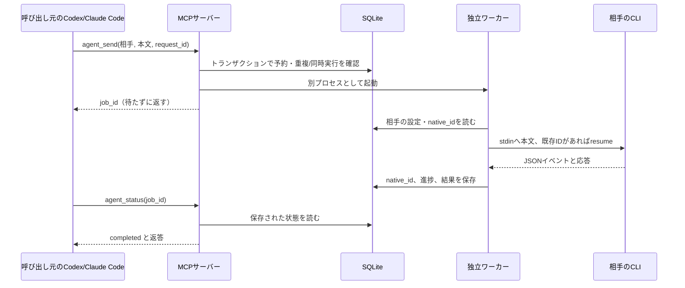
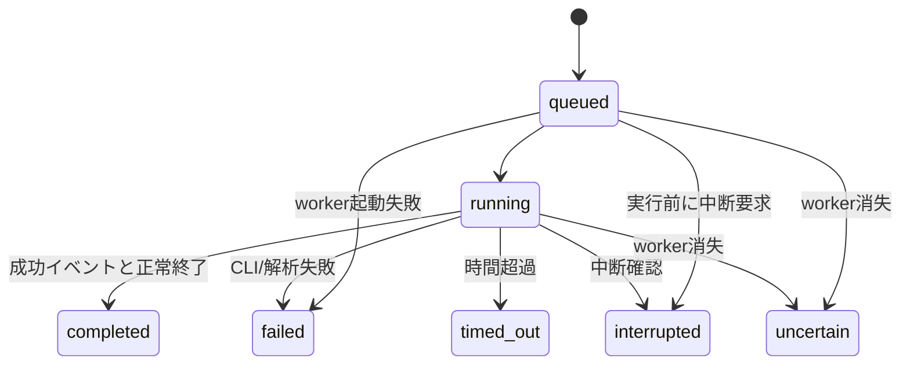

# アーキテクチャ

Local Session Bridge は、名前を付けた相談相手に、必要なときだけメッセージを送り、
前回の会話の続きとして返答を受け取るローカル MCP サーバーです。
Python の3モジュールが中核で、実行基盤に大きなフレームワークは使いません。

## 役割分担

| モジュール | 役割 |
|---|---|
| `server.py` | FastMCPによるstdio窓口。作成・一覧・送信・状態・履歴・中断の6ツール。 |
| `store.py` | SQLiteで相手とジョブを保持。名前とnative IDの対応、重複送信・同時実行を制御。 |
| `runner.py` | detached workerの起動、CLIコマンド構築、JSONイベントの解釈、時間制限・中断。 |

MCPサーバーは各ホストが起動できます。同じ保存先を指定すれば、双方から同じ相手へ
接続できます。各相手のCLIは一回の返答で終了します。次の送信時に
Codexの `exec resume` またはClaude Codeの `--resume` で再開します。

## 記憶がどこにあるか

BridgeのSQLiteには `sessions`、`jobs`、`job_progress` があります。

- sessions: 名前、provider、任意のmodel、初回指示、cwd、native ID。
- jobs: request ID、送信本文、返答、状態、時刻、中断要求、timeout。
- job_progress: phase、イベント件数、受信時刻など。思考本文は格納しません。

次回の推論に使う会話履歴はCLI自身が管理します。Bridgeのjobsを再送して記憶を
再構成する仕組みではありません。したがって、CLI側の履歴を失うとSQLiteだけでは
同じ会話を再開できません。人格や別サービスの記憶ストアの移植も行いません。

呼び出し元のチャット全体を自動転送しません。渡した本文、初回指示、相手自身の履歴が
文脈になります。相談相手の過去の結論は検証対象であり、合意そのものは正しさの証拠ではありません。

## ジョブの状態

同じ相手は1ジョブずつです。SQLiteのトランザクションと一意制約、workerのflockを
組み合わせています。同じrequest IDと本文の再送は既存ジョブを返します。
プロバイダーが受信した直後にworkerが消えた可能性を否定できないので、
`uncertain` は自動再送せず、その相手への新規送信も止めます。

進捗の `thinking` や `result_received`、返答フィールドの存在だけでは完了としません。
成功イベントとCLI正常終了の両方を確認して `completed` にします。
heartbeatはworkerが動いている証拠で、モデルが応答している証拠とは分けます。

## 安全性と拡張範囲

Claudeの道具は無効化し、Codexはread-only/承認なしで起動します。
ただしread-onlyはローカルファイルを読めないという意味ではありません。
空の作業場所もOS上の隔離ではありません。信頼した同一ユーザーのローカル運用が前提です。
詳細は [SECURITY.md](../SECURITY.md)。

初版はstdio・SQLite・CLIアダプターを維持します。HTTP配信、ユーザー認証、
自動相談ループ、既存画面への割り込み、会話の移送は含みません。
公開時の一般化は保存先・設定・導入・テスト・文書の範囲に抑えます。
