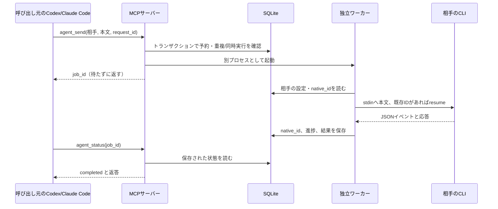
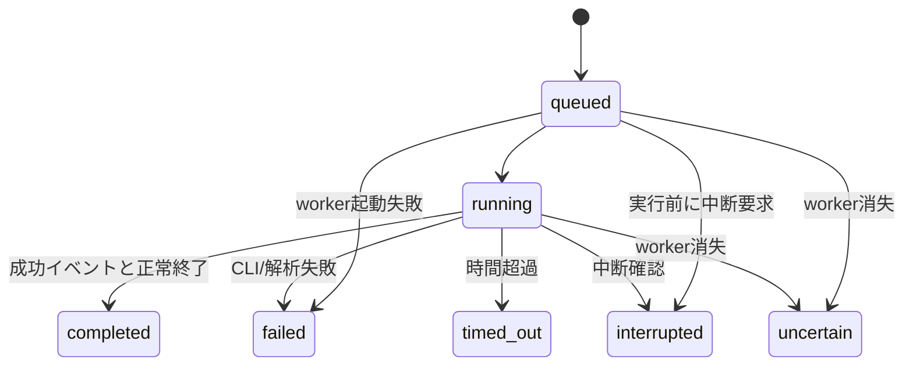

# アーキテクチャ

Local Session Bridge は、名前を付けた相談相手に、必要なときだけメッセージを送り、
前回の会話の続きとして返答を受け取るローカル MCP サーバーです。
Python の小さなモジュール群が中核で、実行基盤に大きなフレームワークは使いません。

## 役割分担

| モジュール | 役割 |
|---|---|
| `server.py` | FastMCPによるstdio窓口。相談相手の6ツールと継続対話の3ツール。 |
| `store.py` | SQLiteで相手とジョブを保持。名前とnative IDの対応、重複送信・同時実行を制御。 |
| `runner.py` | detached workerの起動、CLIコマンド構築、JSONイベントの解釈、時間制限・中断。 |
| `dialogue.py` | 専用の2セッションで交互に発言。往復・時間上限、一時停止・再開・停止を制御。 |
| `usage.py` | CLIが報告したトークン・キャッシュ・累積費用を許可した項目だけ保存。 |

MCPサーバーは各ホストが起動できます。同じ保存先を指定すれば、双方から同じ相手へ
接続できます。各相手のCLIは一回の返答で終了します。次の送信時に
Codexの `exec resume` またはClaude Codeの `--resume` で再開します。

## 記憶がどこにあるか

BridgeのSQLiteには次の状態があります。

- sessions: 名前、provider、任意のmodel、初回指示、cwd、native ID。
- jobs: request ID、送信本文、返答、状態、時刻、中断要求、timeout。
- job_progress: phase、イベント件数、受信時刻など。思考本文は格納しません。
- job_usage: CLI報告のトークン数・キャッシュ数。Codexはsession累積、Claudeはturn単位。Claudeの推定費用はsession累積。
- dialogues: 不変の開始条件、専用セッションID、状態・制御要求、残り時間と締切。
- dialogue_participants: 専用セッションの所有関係。通常のagent_sendによる割り込みを防止。
- dialogue_turns: 順番とjob ID、予約時点の絶対締切。job予約と同じtransactionで保存。

次回の推論に使う会話履歴はCLI自身が管理します。Bridgeのjobsを再送して記憶を
再構成する仕組みではありません。したがって、CLI側の履歴を失うとSQLiteだけでは
同じ会話を再開できません。人格や別サービスの記憶ストアの移植も行いません。

呼び出し元のチャット全体を自動転送しません。渡した本文、初回指示、相手自身の履歴が
文脈になります。相談相手の過去の結論は検証対象であり、合意そのものは正しさの証拠ではありません。

## ジョブの状態

同じ相手は1ジョブずつです。SQLiteのトランザクションと一意制約、workerのflockを
組み合わせています。同じrequest IDと本文の再送は既存ジョブを返します。
プロバイダーが受信した直後にworkerが消えた可能性を否定できないので、
`uncertain` は自動再送せず、その相手への新規送信も止めます。

進捗の `thinking` や `result_received`、返答フィールドの存在だけでは完了としません。
成功イベントとCLI正常終了の両方を確認して `completed` にします。
heartbeatはworkerが動いている証拠で、モデルが応答している証拠とは分けます。

## 安全性と拡張範囲

Claudeの道具は無効化し、Codexはread-only/承認なしで起動します。
ただしread-onlyはローカルファイルを読めないという意味ではありません。
空の作業場所もOS上の隔離ではありません。信頼した同一ユーザーのローカル運用が前提です。
詳細は [SECURITY.md](../SECURITY.md)。

stdio・SQLite・CLIアダプターを維持します。HTTP配信、ユーザー認証、
無制限の相談ループ、既存画面への割り込み、会話の移送は含みません。

## 上限付きの継続対話

`dialogue_start` は2セッションと開始条件を1 transactionで作成し、独立した
coordinatorを起動します。SQLiteに各発言とjobの対応を保存してからworkerを
起動するため、その間に消失しても新しい発言として自動再送しません。
coordinatorは対話単位のflockを保持し、workerは従来どおりセッション単位のflockを保持します。

各周回で中断要求・締切・直前のjob・往復数を確認します。新規予約も同じ条件を
transaction内で再確認するため、stop/pauseと次の発言が競合しても順序が決まります。
予約したjob自身に絶対締切を保存し、coordinatorが消えてもworkerが残り時間で停止します。
active時間は壁時計を使い、端末スリープも含みます。workerはループ中にも絶対締切を
確認し、復帰時に期限を過ぎていたら停止します。端末時計の巻き戻しには完全対応していません。
終了処理にはSIGINT/SIGTERM/SIGKILLの猶予があり、締切は課金上限ではありません。

pauseは進行中の返答を完了させてから停止し、残り時間を保存します。resumeは
同じ2セッション・残り回数・時間を使います。stopは進行中の返答を中断して終了します。
停止要求とpause確定の競合はtransactionで直列化し、直後のresumeは旧coordinatorの
ロック解放を短時間待って引き継ぎます。

coordinatorのheartbeatが15秒以上途切れ、flockが空ならuncertainにします。
元の締切はそのまま減り続けます。本人側から明示resumeされ、直前のjobが実行中か
完了済みと確認できた場合だけ継続します。worker自体がuncertainなら続行しません。
プロセスを強制終了した直後は状態の検出まで時間がかかる場合があります。

`dialogue_status` は終了済み発言を番号でページングします。実行中の返答ではcursorを
進めません。本文を相手へ渡すのはcompletedだけです。最初の指示・テーマを固定し、
以後は直前の相手の返答だけを送り、各CLI自身のnative履歴から再開します。
キャッシュはprovider側の機能で、期限切れやcompaction後の命中を保証しません。
